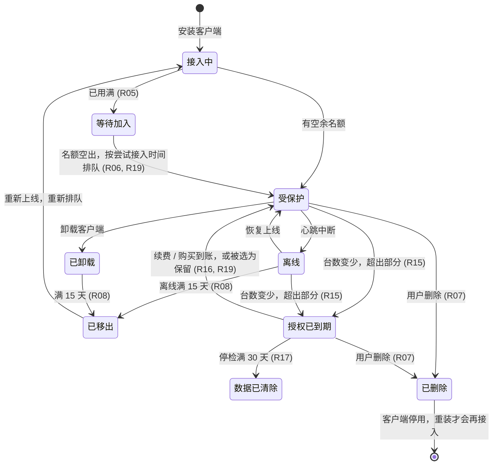
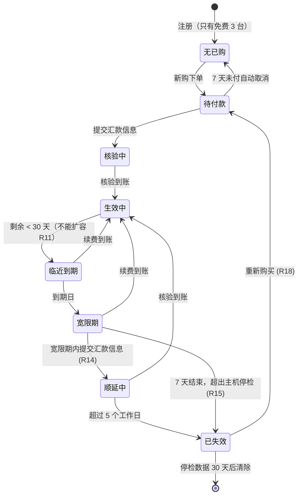

# 德迅安全卫士授权调整 · 变更说明（开发交付）

- 版本：v1 · 2026-11-23
- 依据：决策台账 #10（2026-11-19）、#12（2026-11-20）、#13（2026-11-23）；规则 spec `docs/specs/德迅安全卫士-授权.md`；变更提案 `docs/changes/20261120-卫士授权生命周期/proposal.md`
- 原型基线：卫士画布 LE5c（版本 1795403420）、账号与费用画布 E1uu（版本 1795406581）、服务器画布 IdcServerDetail、官网 Register。标注版原型是这几个版本的快照，入口 `handoff/guard-license/index.html`
- 配套：`02-开发任务清单.md`（按前端 / 后端 / 数据拆分，带验收标准）

## 0. 怎么读

| 编号 | 含义 | 在哪 |
| --- | --- | --- |
| R01–R25 | 授权规则，开发和测试的判定依据 | 本文第 2 节 |
| C01–C36 | 原型改动点，标注版原型上的圆形编号和这里一一对应 | 本文第 4 节、标注版原型 |
| E01–E16 | 异常与边界场景 | 本文第 5 节 |
| Q1–Q6 | 原型和规则还不一致、需要 77 确认的地方 | 本文第 7 节 |
| FE / BE / DA | 前端、后端、数据任务 | `02-开发任务清单.md` |

标注颜色：**绿色 = 新增**，**蓝色 = 修改**，**红色 = 删除**（删除项的原元素已不在页面上，标在原位置附近或只在文档里列出），**橙色 = 待确认**。

## 1. 这次改了什么（一句话版）

德迅安全卫士从「基础版 / 企业版」改成**不分版本、每个账号免费 3 台、超出按台购买**。授权只数台数，不绑 IP、不绑设备、不做激活。在这个基础上补齐了完整的生命周期：首次开通、购买、扩容、续费（可减台）、到期宽限、停止检测、重新购买、退款，以及每一步的异常处理。

推翻的旧规则：

| 旧规则 | 新规则 | 依据 |
| --- | --- | --- |
| 2026-10-30 基础版 / 企业版划分 | 不分版本，全部功能（含 AI 研判、威胁狩猎）对所有账号开放 | #10 |
| 「未授权 · 只告警不防护」状态 | 用满后新主机不能加入；台数变少后超出的主机停止检测 | #10、#12 |
| 2026-11-10「不支持降配，到期不续再买」 | 仅卫士授权：续费时可以减少台数（其他产品不变） | #13 |
| 插件单独授权（「安装插件 / 插件授权」） | 已于 11-06 取消插件；能力默认开启，客户端自动下载 | 11-06 |
| 授权「转移权益」、超出授权「52 / 70 / 超出 18」概览 | 授权不能转移；没有「超出」这个状态 | #13 |

## 2. 授权规则

### 2.1 额度与计数

| 编号 | 规则 | 边界 / 补充 |
| --- | --- | --- |
| R01 | 不分版本，所有功能对每个账号开放 | 菜单、能力页不再按版本隐藏或置灰 |
| R02 | 每个账号免费 3 台，**注册即发**，不需要实名，长期有效 | 德迅云服务器随服务器赠送防护，默认自动安装，**不占** 3 台免费名额，也不占已购台数 |
| R03 | 授权只数台数：不绑 IP、不绑设备、不做激活 | 换机器 = 删除旧主机 + 安装新主机 |
| R04 | **已用台数** = 受保护 + 离线 + 已卸载 + 接入中的主机数 | 只有「删除」和「离线 15 天自动移出」会释放名额。随服务器赠送的主机不计入。「授权已到期」的主机算不算，见 Q3 |
| R05 | 已用满时新主机不能加入：接入记录显示「没能加入 · 授权已用满」，资产列表显示「未受保护 · 授权已用满」 | 客户端装好也不会加入，不报错，进等待队列 |
| R06 | 名额空出时，等待中的主机按**尝试接入时间**先后自动加入 | 「尝试接入时间」取该主机第一次被拒绝的时间，重复尝试不刷新 |
| R07 | 删除主机 = 停用该客户端，立即释放 1 个名额；以后要重新安装客户端才会再接入 | 删除后客户端不会再自动上报，也不进等待队列 |
| R08 | 离线超过 15 天的主机自动移出列表并释放名额（设置项，默认开）。自动移出**不停用**客户端，重新上线后按 R06 排队加入 | 已卸载的主机也按离线计入 15 天 |

### 2.2 购买、扩容、续费

| 编号 | 规则 | 边界 / 补充 |
| --- | --- | --- |
| R09 | 超出 3 台按台购买，按年计费（价格待定），只支持对公转账，**核验到账后生效**。买授权、续费、付款需要个人实名 | 未实名可以填单，提交时引导实名，订单保存为草稿 |
| R10 | **扩容**并入已有授权：所有已购授权只有一个到期日；扩容的台数按剩余天数折算价格。购买入口只有「选购产品」（AcctPurchase） | 没有已购授权时是「新购」（选台数 + 期限）；有时是「扩容」（只选台数） |
| R11 | 剩余不足 30 天时不能扩容，引导先续费，续费到账后再扩容 | 按「当前到期日 − 今天 < 30 天」判断 |
| R12 | 同一份授权同时只允许 **1 笔待付款订单**（续费 / 扩容互斥） | 已有待付款单时，选购页和续费页的提交按钮变「去付款」，并显示订单号 |
| R20 | 续费可以**减少**台数，不能增加（增加走扩容）。减量从当前到期日起生效 | 下单时提示「到期日起 N 台停止检测」，到期前可以更换保留主机。宽限期内续费的生效时间见 Q1 |

### 2.3 到期、宽限、停止检测、恢复

| 编号 | 规则 | 边界 / 补充 |
| --- | --- | --- |
| R13 | 已购授权到期后宽限 **7 天**：检测、告警照常，**自动处置暂停**；宽限期内**不再接入新主机**、**不能扩容**，只能续费 | 宽限期内被删除主机空出的名额也不给新主机 |
| R14 | 宽限期内提交了汇款信息，宽限期顺延到核验结束，**最多顺延 5 个工作日**；核验不匹配（需要补材料）也计入这 5 天，超期按 R15 停止检测 | 工作日需要节假日日历 |
| R15 | 台数变少（宽限结束、退款、续费减台数）时，主机**不移出列表**：按**最后接入时间倒序**，超出授权台数的主机变为「未受保护 · 授权已到期」，停止检测。免费 3 台不受影响 | 默认保留最早接入的主机。随服务器赠送的主机不参与计算 |
| R16 | 「更换保留主机」：在授权管理里选择哪几台继续检测。**只有「卫士管理」角色**能操作 | 可以在停检前（宽限期内、减量生效前）提前选，也可以停检后换 |
| R17 | 停止检测的主机，风险和事件记录保留 **30 天**，页面写明「数据保留至 X」；30 天后删除 | 德迅服务器停机的主机跟随服务器保留期（7 天），页面同样显示「数据保留至 X」 |
| R18 | 过了宽限期，按钮变「**重新购买**」，新授权从到账日起算，和原授权无关 | 这时选购页按「新购」计算 |
| R19 | 续费或购买到账后的恢复顺序：先恢复「授权已到期」被停的主机（按最早接入的顺序，买几台恢复几台），再让「没能加入」的主机按尝试接入时间加入 | 恢复后数据接着用（30 天内） |

### 2.4 退款、转移、通知、权限

| 编号 | 规则 | 边界 / 补充 |
| --- | --- | --- |
| R21 | 退款按订单退，退掉该订单买的台数，之后按 R15 处理 | 原路退回付款对公账户，不进余额；已开发票需先退回 |
| R22 | 授权不能转给其他账号（V1）。德迅服务器过户时，赠送的防护随服务器走 | 权益转移页面不出现卫士授权 |
| R23 | 通知：到期前 30 / 7 / 1 天、宽限期中、宽限期结束有主机被停时（站内信 + 短信，发给主账号和卫士管理，列出被停主机） | 卫士「通知设置」和账号「消息」两处都要有 |
| R24 | 付款、续费沿用现有权限（主账号 / 管理员 / 财务）；更换保留主机见 R16 | — |
| R25 | 「到期不续」放在我的产品卡片「更多」菜单，可以撤销。卫士的确认框多一句「宽限期后超出免费 3 台的主机停止检测」 | 只改续费意向，不生成订单；见 Q2 |

## 3. 对象与状态流转

### 3.1 业务对象

| 对象 | 关键字段 | 说明 |
| --- | --- | --- |
| 授权额度（账号级） | 免费台数（固定 3）、已购台数、到期日、宽限截止日、顺延截止日、已用、等待数 | 一个账号只有一份已购授权（扩容并入），所以只有一个到期日 |
| 授权来源 | 注册赠送 / 在线购买 / 随服务器赠送 | 随服务器赠送单独计数，跟随服务器到期 |
| 主机 | 授权状态（见 3.2）、首次接入时间、最后接入时间、尝试接入时间、停检时间、数据保留截止日、是否保留（更换保留主机的选择） | — |
| 订单 | 类型（新购 / 扩容 / 续费 / 重新购买）、台数、期限、折算天数、状态（见 3.4） | 一个授权最多 1 笔待付款 |

### 3.2 主机授权状态

| 状态 | 页面文案 | 占名额 | 检测 | 自动处置 |
| --- | --- | --- | --- | --- |
| 接入中 | 接入中 | 是 | — | — |
| 受保护 | 受保护 | 是 | 是 | 是（宽限期内暂停） |
| 等待加入 | 未受保护 · 授权已用满 / 接入记录「没能加入 · 授权已用满」 | 否 | 否 | 否 |
| 离线 | 未受保护 · 离线 | 是 | 否 | 否 |
| 已卸载 | 未受保护 · 已卸载 | 是 | 否 | 否 |
| 授权已到期 | 未受保护 · 授权已到期（数据保留至 X） | 是（见 Q3） | 否 | 否 |
| 已移出 | 不在列表 | 否 | 否 | 否 |
| 已删除 | 不在列表 | 否 | 否 | 否 |

「未受保护」的原因从 6 种变成 7 种：未安装、已卸载、部署失败、离线、检测过期、授权已用满、**授权已到期**（新增）。

### 3.3 已购授权状态

### 3.4 订单状态（卫士授权相关）

待付款 → 付款核验中 →（核验未匹配 → 补充汇款信息 → 付款核验中）→ 已付款 → 已完成；待付款 7 天未付 → 已取消；付款核验中超过 2 个工作日显示「已超 N 个工作日」；已完成 → 申请退款 → 已退款（按 R21 减台）。已付款但开通失败显示「已付款 · 开通失败」，引导提交工单。

### 3.5 关键计算

- **可用台数** = 3 + 已购台数（生效中 / 宽限期 / 顺延中）− 已用台数。宽限期内可用台数不再分配给新主机（R13）。
- **停检名单**：台数变少后，可保留台数 = 3 + 新的已购台数。在「已用」的主机里按用户选择的保留主机优先；没有选择的，按最后接入时间倒序停检（最后接入越晚越先停），其余保留。
- **扩容折算**：扩容金额 = 单价（元 / 台 / 年）× 扩容台数 × 剩余天数 ÷ 365。剩余天数 = 到期日 − 到账日（还是下单日，见 Q4）。取整规则待定。
- **宽限顺延截止日** = min(核验结束日, 宽限截止日起第 5 个工作日)。

## 4. 原型改动点

### 4.1 卫士控制台（画布 LE5c）

| 编号 | 页面 | 类型 | 改了什么 | 规则 |
| --- | --- | --- | --- | --- |
| C01 | 资产列表 SecHosts | 新增 | 未受保护原因筛选和状态标签加「授权已到期」，悬停说明停检原因、数据保留 30 天、到账后恢复顺序 | R15 R17 R19 |
| C02 | 资产列表 SecHosts | 修改 | 删除主机确认框：「客户端会被停用，立刻空出 1 个授权；这台以后要重新安装客户端才会再接入」 | R07 |
| C03 | 资产列表 SecHosts | 修改 | 已卸载主机仍算已用（行内「已卸载 · 10-29 由 root 卸载」） | R04 R08 |
| C04 | 授权管理 SecLicense | 修改 | 概况第 4 格「宽限期剩余 4 天 · 11-08 后 54 台停止检测」 | R13 R15 |
| C05 | 授权管理 SecLicense | 修改 | 宽限期提示：检测告警照常、自动处置暂停、宽限期内不接入新主机；11-08 后按最后接入时间停检，数据保留 30 天 | R13 R15 R17 |
| C06 | 授权管理 SecLicense | 修改 | 用满提示：删除旧主机立刻空出名额；先恢复被停主机再排队；卸载仍占名额；离线 15 天移出后重新排队；服务器赠送不占 | R04–R08 R19 |
| C07 | 授权管理 SecLicense | 新增 | 购买授权行加「更换保留主机」，打开抽屉：最多选 3 台（免费额度），默认最早接入的 3 台，至少保留 1 台 | R16 |
| C08 | 授权管理 SecLicense | 修改 | 购买授权行状态「宽限期 · 宽限至 11-08」，操作「续费」 | R13 |
| C09 | 安全总览 SecHome | 修改 | 顶部告警条「授权已到期」：宽限期还剩 4 天，11-08 后 54 台停检，数据保留 30 天 | R13 R15 R17 |
| C10 | 安全总览 SecHome | 待确认 | 授权卡「已购授权到期 11-01 · 数据保留至 11-08」应为「宽限至 11-08」，见 Q5 | R13 R17 |
| C11 | 客户端管理 SecAgent | 修改 | 安装页用满提示：有空余名额后按尝试接入的先后自动加入；宽限期内不接入新主机，请先续费 | R05 R06 R13 |
| C12 | 通知设置 SecNotify | 修改 | 「授权到期」通知项加「宽限期结束主机停止检测（列出被停主机）」 | R23 |
| C13 | 客户端能力列表（共用） | 删除 | 去掉「安装插件 / 插件授权」，操作统一为「管理」，能力默认开启、客户端自动下载 | R01 |

### 4.2 账号与费用（画布 E1uu）

| 编号 | 页面 | 类型 | 改了什么 | 规则 |
| --- | --- | --- | --- | --- |
| C14 | 选购产品 AcctPurchase | 修改 | 页面改成费用中心结构：左侧菜单（订单）、购买资源表格 + 合计、付款与票据、协议勾选 + 提交订单 | R09 R10 |
| C15 | 选购产品 AcctPurchase | 新增 | 页头「演示」切换 6 种状态（只在原型里，开发按 4.5 的条件判断，不做切换控件） | 见 4.5 |
| C16 | 选购产品 AcctPurchase | 删除 | 「购买产品」下拉去掉，固定为「德迅安全卫士 · 主机授权」；服务器去服务器选购页，按规格买的产品去官网产品页 | R10 |
| C17 | 选购产品 AcctPurchase | 新增 | 「购买方式」：新购授权 / 扩容 · 并入现有授权 / 重新购买授权，下方一行说明 | R10 R18 |
| C18 | 选购产品 AcctPurchase | 新增 | 服务期限：新购和重新购买可选 1 个月–3 年；扩容不能选，显示「跟随现有授权，到期 2027-01-26（折算 64 天）」 | R10 |
| C19 | 选购产品 AcctPurchase | 新增 | 状态提示条：宽限期 / 不足 30 天 / 有待付款单 / 已过宽限期，各带一个去向按钮 | R11 R12 R13 R18 R19 |
| C20 | 选购产品 AcctPurchase | 新增 | 台数旁实时提示：「购买后共 N 台（含免费 3 台）」；重新购买时「到账后恢复 N 台被停主机，其余 M 台仍停止检测」 | R19 |
| C21 | 选购产品 AcctPurchase | 修改 | 提交按钮：拦截态置灰；有待付款单时变「去付款」 | R11 R12 R13 |
| C22 | 选购产品 AcctPurchase | 修改 | 顶部说明条：免费 3 台、当前已用、只数台数、服务器赠送不占、下单前需个人实名 | R02 R03 R09 |
| C23 | 确认订单 BillConfirm | 新增 | 「卫士授权台数」步进器：只能减不能加，减少时提示停检影响，加台数引导扩容 | R20 |
| C24 | 确认订单 BillConfirm | 修改 | 说明条「保留期内续费，防护立即恢复」改为「核验到账后恢复」，并写明卫士可减台数 | R14 R20 |
| C25 | 确认订单 BillConfirm | 修改 | 合计「¥X + 卫士授权（价格待定）」 | R09 |
| C26 | 我的产品 · 按资源 AcctSubs | 修改 | 卫士行：状态「宽限期 · 宽限至 11-08」，到期 2026-11-01；宽限期内去掉「扩容」，只留续费 | R13 |
| C27 | 我的产品 · 按产品 AcctProducts | 新增 | 卡片「更多」菜单：到期不续 / 撤销到期不续、操作记录 | R25 |
| C28 | 我的产品 · 按产品 AcctProducts | 待确认 | 卫士卡片仍写「10-25 已到期 · 保留至 11-08」「数据保留到 11 月 8 日」，宽限期内还有「扩容授权」按钮，见 Q5 | R13 R17 |
| C29 | 消息 Notifications | 修改 | 授权到期消息：「宽限期到 11-08，之后超出免费 3 台的 54 台主机停止检测；续费核验到账后恢复」 | R23 |
| C30 | 订单 BillOrders | 新增 | 订单状态补齐：付款核验中 · 已超 N 个工作日、已付款 · 开通失败、申请退款、已退款页签、用量账单 | R21 |
| C31 | 收支明细 BillBalance | 修改 | 余额只展示，不能付款；退款原路退回付款账户，不进余额 | R21 |
| C32 | 对公转账付款 BillPayment | 新增 | 付款须知加「付款前需完成个人实名认证」 | R09 |
| C33 | 提交工单 SupTicketNew | 新增 | 从订单「申请退款」进入时带出退款申请说明（财务审核、原路退回、已开票需先退回、退款后服务停止） | R21 |
| C34 | 产品详情 AcctProductDetail、授权使用情况 AcctUsage | 删除 | 两页已删除；「转移权益」和「授权 52 / 已用 70 / 超出 18」概览随之去掉。授权预警并入「我的产品 › 按资源」筛选 | R22 |

### 4.3 服务器控制台

| 编号 | 页面 | 类型 | 改了什么 | 规则 |
| --- | --- | --- | --- | --- |
| C35 | 服务器详情 IdcServerDetail | 修改 | 卸载客户端弹窗：去掉「释放 1 个授权，可以绑定到其他服务器」，改为「防护随服务器赠送，不占授权台数；卸载后停止检测，不会空出其他名额」 | R02 R03 |

### 4.4 官网

| 编号 | 页面 | 类型 | 改了什么 | 规则 |
| --- | --- | --- | --- | --- |
| C36 | 注册 Register | 修改 | 「注册后完成实名认证，即可申请免费试用」改为「注册即送德迅安全卫士 3 台主机防护；购买产品前需完成实名认证」 | R02 R09 |

### 4.5 多状态页面的切换条件

**选购产品 AcctPurchase（6 种状态）**，按顺序判断，命中即停：

| # | 状态 | 判断条件 | 页面表现 | 规则 |
| --- | --- | --- | --- | --- |
| 1 | 有待付款单 | 该授权存在状态为「待付款」的新购 / 扩容 / 续费订单 | 提示订单号；台数不可改；按钮「去付款」→ 付款页 | R12 |
| 2 | 已过宽限期 | 有已购授权，且已失效（宽限期和顺延都已结束） | 标题「重新购买」；可选台数 + 期限；提示被停主机数和数据保留日期；台数旁提示恢复几台 | R18 R19 |
| 3 | 宽限期内 | 到期日 < 今天 ≤ 宽限 / 顺延截止日 | 提示「宽限期内不能扩容」；台数不可改；按钮置灰；「去续费」 | R13 |
| 4 | 不足 30 天 | 生效中，且到期日 − 今天 < 30 天 | 提示剩余天数；台数不可改；按钮置灰；「去续费」 | R11 |
| 5 | 扩容 | 生效中，且剩余 ≥ 30 天 | 只选台数；期限显示「跟随现有授权，折算 N 天」 | R10 |
| 6 | 新购 | 没有已购授权（从未买过，或已退款且无剩余） | 选台数 + 期限 | R09 |

**确认订单 BillConfirm 的卫士台数步进器**：默认等于现有已购台数；最小 0（等于不续卫士），最大等于现有台数；小于现有台数时显示停检提示；有待付款单时整页按 R12 拦截。

**授权管理 SecLicense 的更换保留主机抽屉**：只对「卫士管理」角色显示入口；可选数量上限 = 变少后的授权台数（示例为 3）；不能全部取消。

## 5. 异常与边界场景

| 编号 | 场景 | 期望行为 | 规则 |
| --- | --- | --- | --- |
| E01 | 新用户注册后装 4 台 | 前 3 台加入；第 4 台「没能加入 · 授权已用满」；买 5 台核验到账后第 4 台自动加入 | R02 R05 R06 |
| E02 | 用满时同时有 3 台在等待，删除 1 台 | 尝试接入最早的那台加入，其余继续等待 | R06 R07 |
| E03 | 被删除的主机客户端仍在运行 | 不再接入、不进等待队列；重装客户端后作为新主机接入 | R07 |
| E04 | 主机离线 15 天被自动移出，之后又上线 | 不停用客户端；重新上线进等待队列，有名额时加入 | R08 |
| E05 | 关闭了「离线 15 天自动移出」 | 离线主机一直占名额 | R04 R08 |
| E06 | 宽限期内删 1 台、装 1 台新主机 | 新主机不加入，提示先续费 | R13 |
| E07 | 宽限期第 6 天提交汇款，核验金额不对 | 宽限顺延，补材料重新核验；顺延满 5 个工作日仍未到账，按 R15 停检 | R14 |
| E08 | 54 台授权宽限期结束未续费 | 54 台按最后接入时间倒序停检（保留 3 台，或保留用户选择的 3 台）；发站内信 + 短信，列出被停主机 | R15 R16 R23 |
| E09 | 停检后 20 天重新购买 30 台 | 按新购从到账日起算；到账后先恢复最早接入的 30 台被停主机，其余 24 台仍停检；再处理等待队列 | R18 R19 |
| E10 | 停检满 30 天还没买 | 被停主机的风险和事件记录删除，主机仍在列表 | R17 |
| E11 | 54 台续费时减到 30 台 | 减量从当前到期日起生效，下单时提示「到期日起 24 台停止检测」，到期前可换保留主机 | R20 R16 |
| E12 | 同一授权已有待付款续费单，又去扩容 | 拦截，按钮变「去付款」，提示订单号 | R12 |
| E13 | 剩 17 天时扩容 | 拦截，引导先续费 | R11 |
| E14 | 退掉扩容订单的 4 台 | 已购台数 −4，超出部分按 R15 停检 | R21 |
| E15 | 德迅服务器到期停机 | 该主机跟随服务器保留期，不影响授权台数；页面显示「数据保留至 X」 | R02 R17 |
| E16 | 非「卫士管理」角色打开授权管理 | 看不到「更换保留主机」；付款续费按主账号 / 管理员 / 财务权限 | R16 R24 |

## 6. 影响的接口与数据（概要）

后端需要提供或改动的能力，详细见任务清单 BE / DA 部分：

- 授权额度查询：免费 / 已购 / 服务器赠送台数、已用、等待数、到期日、宽限截止、顺延截止、当前状态（对应 4.5 的 6 种判断）
- 主机授权状态：7 种未受保护原因，含「授权已到期」和数据保留截止日
- 接入控制：用满拒绝、等待队列（按尝试接入时间）、宽限期内拒绝新接入、删除即停用客户端
- 定时任务：宽限期结束停检、顺延截止判断、离线 15 天移出、停检 30 天数据清除、到期前 30 / 7 / 1 天通知
- 订单：新购 / 扩容（折算）/ 续费（可减台）/ 重新购买，单授权单笔待付款锁，退款减台
- 保留主机选择：读写接口，限「卫士管理」角色
- 通知：宽限期结束停检通知（站内信 + 短信，列出被停主机）

## 7. 待确认（原型与规则不一致）

| 编号 | 问题 | 建议 | 涉及 |
| --- | --- | --- | --- |
| Q1 | 续费减台的生效时间：spec 写「从当前到期日起」，确认订单页减台提示写「核验到账后这 N 台停止检测」 | 到期前续费：从当前到期日起生效；宽限期内续费（到期日已过）：核验到账即生效。两处文案按这个区分 | R20、C23 |
| Q2 | 「到期不续」确认框写「不支持降配」，但卫士授权续费可以减台数 | 卫士的确认框去掉「不支持降配」，改为「想少买几台，续费时减少台数即可」 | R25、C27 |
| Q3 | 「授权已到期」的主机算不算已用：不算的话，新主机能占它的名额，恢复时会冲突 | 算已用，直到被删除或数据清除；这样到账后能按 R19 先恢复它们 | R04 R15 |
| Q4 | 扩容折算的剩余天数按下单日还是到账日算：对公转账有 1–2 个工作日差 | 按到账日算；下单页显示的是按下单日预估，付款页注明「以到账日为准」 | R10 |
| Q5 | 示例日期还有旧口径：安全总览授权卡「数据保留至 11-08」、我的产品卫士卡片「10-25 已到期 · 保留至 11-08」「68 / 50 台」并在宽限期内显示「扩容授权」 | 统一为「2026-11-01 到期 · 宽限至 11-08」「57 / 57 台」，宽限期内去掉扩容按钮；停检后才显示「数据保留至 12-08」 | C10 C28 |
| Q6 | 订单列表示例还有「dx-guard-01 · 授权 +25 台」，和 54 台 = 新购 50 + 扩容 4 对不上 | 改成「授权 +4 台 · 折算至 2026-11-01」 | C30 |

## 8. 不在本次范围

- 不加激活、绑定 IP / 设备；不加在线支付和余额支付
- 价格仍写「待定」；扩容折算的取整规则待价格确定后再定
- 卫士菜单、安全事件、策略模型不变
- 移动端
